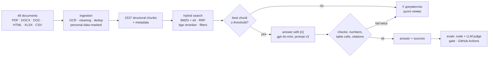
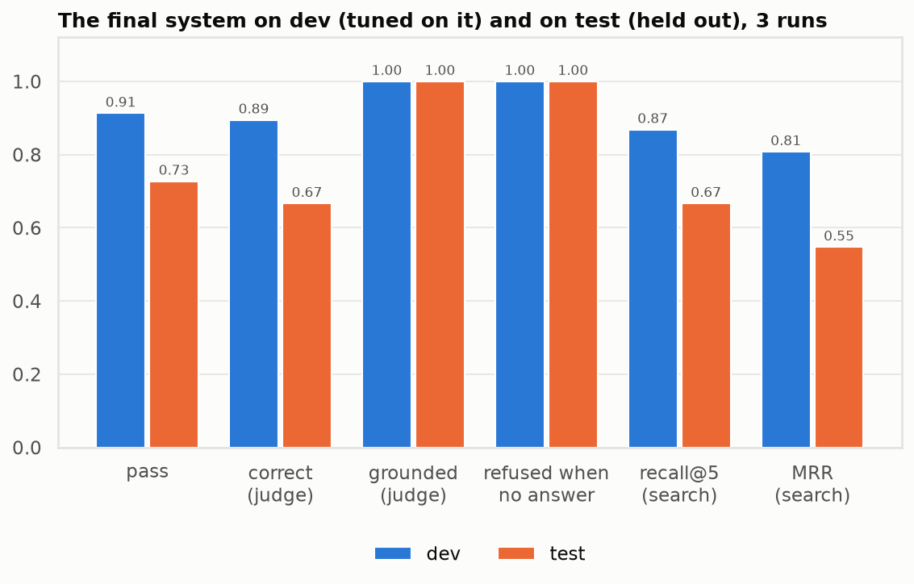
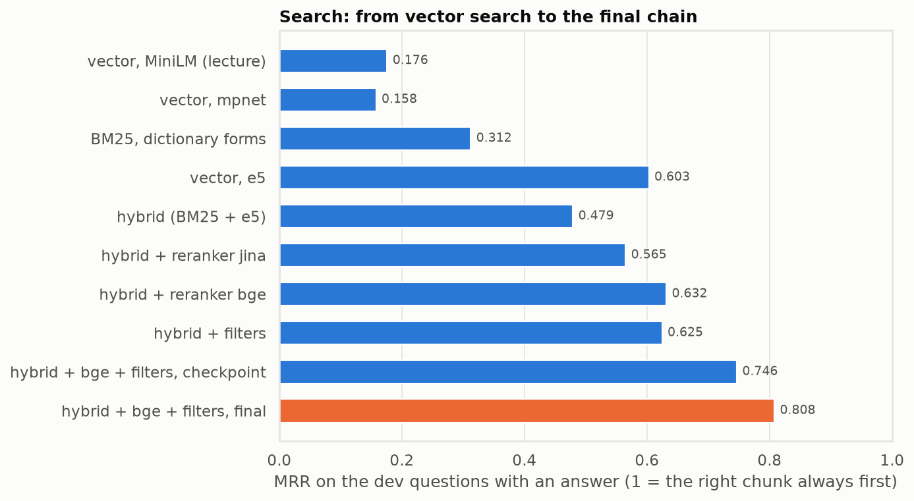
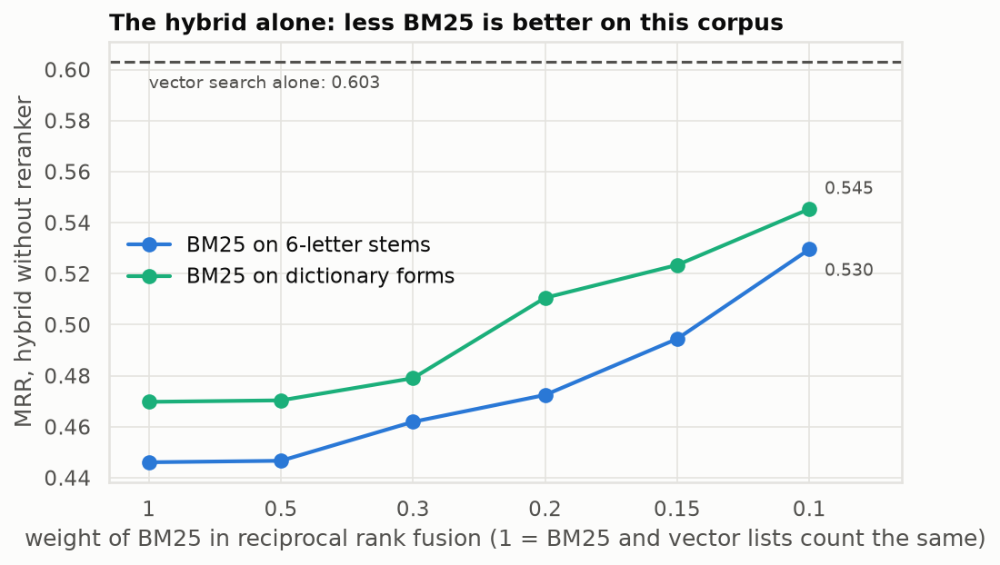
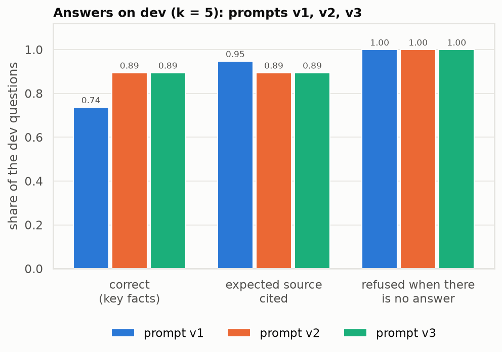
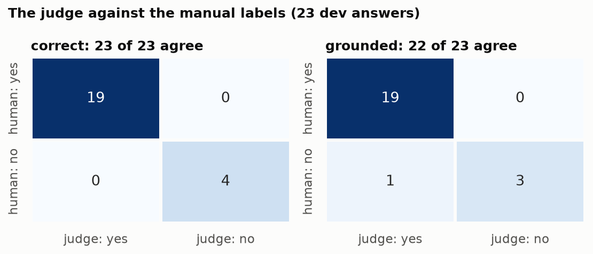

# Homework 2 report: RAG over agro bulletins + evals in CI

An assistant that answers an agro analyst's questions from Ukrainian and English agrometeorological
bulletins and crop statistics, with a source for every statement, says "not in the documents" when the
corpus has no answer, and is checked by an eval pipeline on every push.



## Summary

The final system (prompt v3, k = 5, threshold 0.3, check of table cells), 3 runs of every question, judge
Gemini 2.5 Flash-Lite calibrated against manual labels. Dev was used for every choice; test was held out,
measured once, and measured again after the check of table cells (section 4, all runs in one table).

| | dev (23 questions) | **test (22, held out)** |
|---|---|---|
| **pass** (right + grounded + cited, or a refusal where there is no answer) | 0.91 (21 / 23) | **0.73 (16 / 22)** |
| correct, by the judge | 0.89 (17 / 19) | **0.67 (12 / 18)** |
| correct, by the key facts (code) | 0.89 | **0.72** |
| grounded (faithfulness), by the judge | 1.00 | **1.00** |
| expected source cited | 0.89 | **0.83** |
| "not in the documents" for the questions without an answer | 4 / 4 | **4 / 4** |
| final answers with an unsupported number | 0 | **0** |
| search: recall@5 / hit@5 / MRR | 0.87 / 0.89 / 0.808 | **0.67 / 0.67 / 0.547** |
| cost per 1000 questions: answers + judge | $0.61 + $0.27 | **$0.54 + $0.26** |



What holds on new questions: every answer the system gives is supported by its chunks (in one CI run one
was not, t14, which the check of table cells now catches; section 4), it says "not in the
documents" for every question without an answer, and no unsupported number reaches an answer. What does
not hold as well: the search. Its settings were chosen on dev, and on test it finds the right chunk among
the first five for two questions of three instead of nine of ten; three of the six failures on test
start there (section 6).

Files: results of the evals [evals/results/](evals/results/) (`dev.md`, `test.md`, every answer in the
`.jsonl`), metrics [evals/METRICS.md](evals/METRICS.md), test set [evals/](evals/README.md), judge
calibration [evals/calibration/agreement.md](evals/calibration/agreement.md), experiments of steps 2-3
[results/rag/](results/rag/), prompts with changelogs [prompts/](prompts/).

## 1. Corpus and chunking (step 1)

* **48 documents** in the registry (`data/sources.csv`), 6 formats, Ukrainian and English: 19 decadal
  bulletins and 6 annual reviews of Ukrhydrometcenter, 10 JRC MARS bulletins on Ukraine and 8 JRC news,
  crop statistics of the Odesa oblast office (XLSX) and of the State Statistics Service (CSV), an annex on
  precipitation chemistry (DOC). One annual review is an exact copy and is left out: 47 documents in the
  index. Every document and its hashes: `data/corpus/manifest.csv`; sources and licences:
  [data/corpus/README.md](data/corpus/README.md).
* **The corpus has traps on purpose**: the same month of another year, the same decade of another
  bulletin, a June forecast superseded in September, a preliminary statistics file of 1 October and the
  final one, a document on a neighbouring topic.
* **Ingestion** keeps headings, lists and tables (tables as Markdown); cleaning removes page headers and
  footers, joins hyphenated words, fixes Latin look-alike letters in Cyrillic words; duplicates by
  sha256 of the text and by word 5-gram Jaccard ≥ 0.85.
* **OCR**: one scanned bulletin and two JRC tables are read by a vision model (Gemini 2.5 Flash, prompt
  `prompts/ocr/v1.txt`), transcripts in git (`data/ocr/`). Against EasyOCR on the same pages it reads
  94-100% of the words found in the documents read without OCR, against 61-98%, and keeps the +/- signs
  of the JRC tables ([results/rag/ocr_compare.md](results/rag/ocr_compare.md)).
* **Personal data** (names of analysts and staff, e-mails, phones) is masked before chunking by Presidio
  with spaCy NER for Ukrainian and English plus our rules as a Presidio recognizer: 232 names, 12 e-mails,
  6 phones.

**Chunking**: structural. A chunk never crosses a heading, paragraphs of one section are packed up to 450
tokens, a table is its own chunk and is split by rows with its header row repeated, and every chunk
starts with a context line (document | period | section) that is embedded with the text.

| | structural 300 | **structural 450 (used)** | fixed 450 / overlap 50 |
|---|---|---|---|
| chunks (average tokens) | 2150 (277) | 1537 (372) | 1367 (443) |
| chunks starting mid-sentence | 2.4% | 3.3% | 52.6% |
| table parts without their header row | 0 | 0 | 537 |
| MRR, vector (e5) | 0.570 | **0.603** | 0.523 |
| MRR, hybrid + reranker (bge) | 0.615 | **0.632** | 0.604 |

The bulletins are written section by section ("Зволоження ґрунту", "Стан посівів") and a question is about
one section of one decade; a fixed window glues sections together and cuts tables from their header, so a
cut part no longer says which column is which (537 such parts). The full comparison is in the README,
[Chunking](README.md#chunking).

## 2. Search (step 2)

Embeddings e5 (multilingual-e5-large, local) in Qdrant, BM25 over dictionary forms of the words
(pymorphy3), reciprocal rank fusion with BM25 weight 0.3, the bge cross-encoder reranks the top 20,
filters by year, month, decade, source and language read from the question. Measured on the 19 dev
questions that have an answer (a chunk is relevant when it is from the expected document and contains
the evidence phrase of the test set); every configuration and every question:
[results/rag/retrieval_dev.md](results/rag/retrieval_dev.md).



| experiment | compared | MRR on dev | decision |
|---|---|---|---|
| embedding model | MiniLM (lecture) / mpnet / multilingual e5-large | 0.176 / 0.158 / **0.603** | e5: MiniLM reads 128 tokens and cuts 91% of the chunks |
| chunking | structural 450 / 300 / fixed | 0.603 / 0.570 / 0.523 (vector) | structural 450 |
| words of BM25 | as written / 6-letter stems / dictionary forms | 0.226 / 0.245 / **0.312** | dictionary forms |
| fusion | RRF with BM25 weight 1.0 ... 0.1; relative score fusion 0.9 ... 0.7 | the whole chain: RRF 1.0 0.746, **RRF 0.3 0.808**, relative 0.9 0.756 | RRF 0.3, chosen by the whole chain |
| reranker | jina v2 / bge v2 m3, on the hybrid | 0.565 / **0.632** | bge (~38 s per question on a CPU, scores cached) |
| candidates of the reranker | 20 / 10 | 0.632 / 0.605 | 20 |
| filters from the question | without / with | 0.632 / **0.808** | with |

From the checkpoint `hw2-v1` (BM25 on 6-letter stems, weight 1.0) to the final configuration: MRR
0.746 → **0.808**, recall@5 0.84 → 0.87, recall before the reranker 0.89 → 0.92.



**The hybrid alone is not better than vector search here** (0.479 vs 0.603), unlike in lecture 7: there
the questions contain exact codes that BM25 finds. Here 6 of the 19 dev questions are asked in one
language about a document in the other, where words cannot match, and several traps have the same words
in a bulletin of another year. BM25 pays off in the whole chain: with weight 0.3 it brings 92% of the
expected sources among the 20 candidates of the reranker, against 87% for the fusion that follows the
vector list. Not found on dev: d12 (similar chunks of one bulletin) and d14 (two JRC bulletins with nearly
the same tables).

## 3. Answers with sources (step 3)

`agro/rag/answer.py`, the chain of the lecture example (autoparts-rag-evals): threshold → context → answer
with [n] → checks without a model → one retry → answer withdrawn. Settings: `config.toml [answer]`.

* **Threshold**: the reranker score of the best chunk, turned into 0..1. On dev every question with an
  answer scores 0.89 ... 1.00; of the 4 without one, two score 0.041 and 0.000 (refused without a model
  call), two are near misses at 0.70 and 0.58 (the model says `НЕМАЄ_ВІДПОВІДІ`). The threshold 0.3 is
  half the lowest score of an answerable question, not the gap of dev (0.70 ... 0.89) that rests on two
  questions ([results/rag/threshold_dev.md](results/rag/threshold_dev.md)).
* **Context**: at most 3 chunks of one document in a first pass, then the places left; k = 5 within 3000
  tokens; every chunk numbered [n] with its document, period and section.
* **Checks** (`agro/rag/verify.py`): every number must be in the chunk its sentence cites, with the same
  unit ("24 769" = "24,769"; "22-50 мм" = 22 and 50 мм); every [n] must be a chunk that was given; every
  sentence with a fact needs a [n]. A failed check gets one retry with the problems listed; if numbers or
  citations are still wrong, the answer is withdrawn.

**k**: 3 chunks lose answers, 10 add none and cost 10-20% more; k = 5 for every prompt
([results/rag/answers_dev_v1.md](results/rag/answers_dev_v1.md), `_v2.md`, `_v3.md`).

| k (prompt v3) | correct (key facts) | expected source cited | false refusals | $ / 1000 |
|---|---|---|---|---|
| 3 | 15 / 19 | 0.84 | 2 / 19 | 0.45 |
| **5** | **17 / 19** | **0.89** | 2 / 19 | **0.59** |
| 10 | 17 / 19 | 0.95 | 1 / 19 | 0.65 |

The one more answer of k = 10 (d12) is wrong; k = 5 refuses it.

**Prompts v1 → v2 → v3** ([prompts/rag/CHANGELOG.md](prompts/rag/CHANGELOG.md)), each measured on dev
with the same test set:



| | v1 | v2 | v3 |
|---|---|---|---|
| what changed | the first prompt | language of the answer named by the code; a partial answer instead of a refusal; the value of the named oblast over the general one; wheat / winter wheat told apart; the context limit per document in two passes | "what is missing" only for a part of the question with no answer |
| found by | | the errors of v1 on dev | the manual labelling of the answers (step 4) |
| correct (key facts), k = 5 | 14 / 19 | 17 / 19 | 17 / 19 |
| answers with an unneeded "Інших даних… немає" | 0 / 18 | 5 / 17 | 0 / 17 |

| question | v1 | v2, v3 |
|---|---|---|
| d06 (English, soil freezing in Kyiv oblast) | "1-5 см", in Ukrainian | "7-10 cm in some areas", in English |
| d07 (wheat harvest 2023) | 209 867.9: the table of winter wheat; the wheat chunk was dropped by the limit of 3 chunks per document | 217 538.5 |
| d16 (snow on 10 March 2024) | "Ні, снігу не було" | "No, there was no snow on the fields" |
| d12 (sums of temperatures) | a wrong value of a neighbouring sum | a refusal: the chunk with the answer is not found |

Cited source 0.95 → 0.89 from v1 to v2 is d12: a wrong answer with a citation became a refusal.

**The check of numbers at work**: to the question how the JRC wheat forecast changed from June to September
2025 (d14), the first answer of the model added "прогноз зріс на 3 094 тис. т", a difference it computed
itself; the check found the number in no chunk, and the retry answered without it.

## 4. Evals (step 4)

**Test set**: 45 questions written by the author (an agronomic data scientist) from the documents, each
with the expected answer, key facts and the source with an evidence phrase that the lint finds in the
document ([evals/README.md](evals/README.md)). Dev 23 (tuning), test 22 (held out).

| kind | dev | test | | kind | dev | test |
|---|---|---|---|---|---|---|
| exact | 3 | 4 | | stale (outdated version) | 2 | 2 |
| paraphrase | 3 | 2 | | similar documents | 2 | 2 |
| cross-lingual | 3 | 2 | | several documents | 2 | 2 |
| table | 2 | 2 | | yes / no | 2 | 2 |
| **no answer in the corpus** | **4** | **4** | | | | |

**Scoring** (`evals/scoring.py`, `evals/judge.py`; every metric, why and who computes it:
[evals/METRICS.md](evals/METRICS.md)):

* by the code: expected source among the citations, key facts in the answer, a refusal where there is no
  answer and none where there is one, numbers supported by the cited chunk, sentences without [n];
* by the LLM judge (Gemini 2.5 Flash-Lite, another family than the generator, prompt `prompts/judge/v1.txt`):
  `correct` against the expected answer, and `grounded`, the faithfulness check: every statement
  supported by the chunks the model got;
* an answer **passes** when it is correct and grounded by the judge and cites an expected document; a
  question without an answer passes when it is refused.

**Calibration of the judge**: 23 dev answers (the 17 answers of the system and 6 wrong answers of other
runs) labelled by hand by the author, blind (no prompt version, no automatic verdict, shuffled rows), with
the same definitions the judge gets ([evals/calibration/](evals/calibration/)):



| verdict | agreement | Cohen's kappa | false pass | false fail | 95% interval of the agreement |
|---|---|---|---|---|---|
| correct | 23 / 23 | 1.00 | 0 | 0 | 0.86 ... 1.00 |
| grounded | 22 / 23 | 0.83 | 1 | 0 | 0.79 ... 0.99 |

The disagreement (L03): an answer gave Kyiv oblast the value the chunk gives for most of the country
("1-5 см"; for Kyiv oblast the chunk says 7-10 cm); the judge took it as supported. So the judge can miss a
value moved from the country to an oblast, and its `grounded` is an upper bound. Limits: 23 answers, only
4 negatives per verdict; the examples in the judge prompt (winter wheat for wheat, a 2024 column for a
2025 forecast, the country for an oblast) come from errors among the labelled answers, which makes the
agreement somewhat optimistic. The judge prompt was not tuned on the labels. On test the judge also failed
a right answer (t08: 3 003 thousand ha of soybean) for leaving out the comparison with the 5-year average,
which the expected answer gives but the question does not ask: a false fail on a question it had not seen.

**Stability**: in 3 runs of the final system every question passed in all runs or in none. Between two
sessions at temperature 0 one dev answer changed (d19: 4% for maize, then 22%, the share of wheat): the
generator is not fully deterministic, which the thresholds of the gate allow for. Every measurement so far
(CI runs: 1 run of every question; local: 3):

| measurement | system | dev pass | test pass | test grounded | what it shows |
|---|---|---|---|---|---|
| local, 3 runs | before the check of table cells | 0.87 | 0.73 | 1.00 | d19 wrong in this session |
| CI #1 (push of step 4) | the same | 0.91 | 0.73 | 1.00 | d19 right again |
| CI #2 (push of the ingestion fix) | the same | 0.91 | 0.73 | 1.00 | |
| CI #3 (tag) | the same | 0.91 | 0.73 | 0.94 | t14 answered once (below) |
| local, 3 runs ([evals/results/](evals/results/)) | with the check of table cells | 0.91 | 0.73 | 1.00 | the numbers of the summary |

The dev pass of 0.87 / 0.91 is the spread of the model (d19, the only question that changed), not an effect
of the check: it withdrew no answer on dev, and the CI runs before it gave 0.91 as well. On test every
measurement gives 0.73.

**The check of numbers by sentence** (step 4): in the labelling the author found an answer that gave 23 546,
the production of 2024 in the September bulletin, as the June 2025 forecast with a citation of the June
chunk; the check then looked for a number in all cited chunks together and passed it. It now looks in the
chunk of the sentence. On dev this changed one answer (d14 at k = 3: "23,008 [3]", not in chunk [3],
became a refusal) and none at k = 5; a phrase like "Документи не надають…" is now read as a statement of
what is missing.

**The check of table cells** (step 4, v2). In CI run #3 (on the tag) t14 answered once instead of refusing:
it gave the maize yield of Odesa oblast (37.6, the next row of the table) as the yield of wheat. The judge
marked it not grounded (test grounded 0.94, still above the gate), the check of numbers passed it: 37.6 is
in the cited chunk. The same kind of error was already in the manual labels of dev (23 546 moved from the
2024 column to a 2025 forecast). Added a deterministic check (`table_mismatches` in `agro/rag/verify.py`):
a number that stands in the cited chunks only in table cells must have a cell that does not contradict its
sentence: the crop and the oblast (or zone) of its row or table, the year of its column. What the sentence
does not name is not checked, nor a sentence that compares years. A contradiction is an unsupported number:
one retry, then the answer is withdrawn. Checked: unit tests on tables of the corpus (Derzhstat, oblstat,
JRC, bulletin); the saved dev answers (247 answers of every version and k, 125 numbers from table cells): no
new flags; dev and test again, 3 runs each: the metrics did not change, no answer withdrawn; the t14 answer
of CI run #3: flagged ("37.6 ц/га: це значення клітинки (рядок «Odeska (Одеська)», стовпець «2024»,
таблиця «Maize: yield, centners per ha»)"). Test was measured a second time; the rules were written on dev
and on the tables of the corpus, not on the answers of test. The judge runs only in the evals; for a user
only the checks of the code run, so such an answer no longer reaches the user.

**CI** ([.github/workflows/evals.yml](.github/workflows/evals.yml)) on every push and every pull
request: job `checks` (unit tests, lint of the test set; no key) and job `evals`
(every question of dev and test, `make evals`, key `OPENROUTER_API_KEY` in the Secrets of the repository),
then the gate (`evals/gate.py`) against [evals/baseline.json](evals/baseline.json), the means of the final
local run:

| metric | the run fails when |
|---|---|
| pass, correct (judge and key facts), grounded | more than 0.10 below the baseline (about two questions of a split) |
| refusals for the questions without an answer | below 0.75 |
| final answers with an unsupported number | more than 0 |
| recall@5, hit@5, MRR | more than 0.05 below the baseline |

The tolerance is larger than the observed spread (one question between sessions) and covers a reranker on
another CPU; tests in `tests/evals/test_gate.py` show that a run with worse numbers fails. One CI run costs
about $0.04 (45 questions); the report is on the page of the run.

## 5. Dev against test

| kind | dev pass@1 | test pass@1 |
|---|---|---|
| exact | 1.00 | 1.00 |
| stale (outdated version) | 1.00 | 1.00 |
| no answer in the corpus | 1.00 | 1.00 |
| paraphrase | 1.00 | 0.50 |
| table | 1.00 | 0.50 |
| yes / no | 1.00 | 0.50 |
| cross-lingual | 1.00 | 0.50 |
| similar documents | 0.50 | 0.50 |
| several documents | 0.50 | 0.50 |

Two kinds a question, so a kind on test is decided by one question. What carries over without loss:
exact facts, outdated versions, questions without an answer. The drop on test is mostly search (recall@5
0.87 → 0.67): the configuration was chosen on dev, and 19 questions are few to choose among dozens of
configurations.

## 6. Characteristic errors

**1. Neighbouring indicator of the same bulletin (t03, similar to d12 on dev).** *Should be*: on 20 October
2023 the sums of effective temperatures above +5 °С were 75-140 °С above the long-term average. *Was*: "на
20-25 °С більшим за норму". *Why*: a bulletin gives sums of temperatures for different periods; the chunk with
the asked one was 7th, outside the context of 5, and the model answered from another sum, with a correct
citation. The answer is grounded, but not to the
question.

**2. A question in English about a Ukrainian document (t05).** *Should be*: 0.6-0.7 of the annual norm of
precipitation in most districts of Odesa oblast in 2020. *Was*: "The documents do not contain this", by
the threshold. *Why*: the English question did not bring the Ukrainian annual review 2020 among the
candidates, the best chunk was below 0.3. The refusal is honest, but the answer is in the corpus.

**3. The words contradict the numbers (t16).** *Should be*: "Ні: 36,9 ц/га проти 46,0 ц/га по Україні".
*Was*: "Так, урожайність … становила 36.9 ц/га, що нижче середньої по Україні, яка становила 46 ц/га". *Why*:
the numbers and citations are right, so the checks of numbers and citations pass; the yes / no is wrong.
The key fact "Ні" and the judge catch it.

**4. A refusal with the answer in the first chunk (t11).** *Should be*: soybean harvesting began in the
southern oblasts in the third decade of August 2021. *Was*: "У документах цього немає". *Why*: the chunk
ranked first says "місцями у південних областях розпочалося її збирання", and the model still refused. A
likely reason is the hedge "місцями" together with the strict rules of the prompt about periods and
outdated versions; a false refusal is the price of those rules.

**5. A wide table (d13, dev).** *Should be*: 27 c/ha of wheat in Mykolaiv oblast in 2020 and the reason
(drought: 0.6-0.7 of the annual precipitation). *Was*: a refusal in every run. *Why*: the yield is in a
table with a column per year (2019 ... 2025), and the second document (the annual review) is not among the
chunks found; the model neither read the 2020 column nor answered the part it had, though the prompt asks
for a partial answer. On test, t14 (two statistics documents) fails the same way for the second document.

## 7. The path of the work: every experiment and what it decided

In order. Each line is a measurement or a finding, and what changed because of it; the details are in the
sections above and in the files named there.

| step | tried or found | result | decision |
|---|---|---|---|
| 1 | EasyOCR on the scanned bulletin and two JRC tables | 61-98% of its words are known from the other documents; in the JRC tables it kept the sign of 2 numbers, where the pages have 49 and 97 signed numbers | a vision model (Gemini 2.5 Flash) reads the scans: 94-100% known words, the signs kept ([ocr_compare.md](results/rag/ocr_compare.md)) |
| 1 | OCR prompt v2 for the two pages where the model looped on a printed rule of dashes | did not help: the dashes are printed, not a table | the two pages (the imprint: no agro facts, personal data) are left out of OCR; prompt v1 kept ([CHANGELOG](prompts/ocr/CHANGELOG.md)) |
| 1 | masking personal data by rules only | missed names in lists of initials ("Cerrani, I.") and Ukrainian names with one initial | Presidio with spaCy NER for Ukrainian and English plus the rules as a Presidio recognizer, and a second check after masking: 232 names, 12 e-mails, 6 phones |
| 1 | structural chunks of 300 / 450 tokens against fixed 450 / overlap 50 | fixed: 52.6% of chunks start mid-sentence, 537 table parts lose their header | structural 450 (best MRR, vector and with the reranker) |
| 2 | three embedding models | MiniLM 0.176, mpnet 0.158, e5 0.603 | e5 (multilingual, reads 512 tokens) |
| 2 | hybrid against vector search | the hybrid alone is worse (0.479 vs 0.603): cross-lingual questions, traps with the same words | BM25 kept for the chain (more right candidates for the reranker), not alone |
| 2 | words of BM25; 18 ways to fuse the two lists | dictionary forms best (0.312); by the hybrid alone the relative fusion would win (0.603), by the whole chain RRF with weight 0.3 wins (0.808 vs 0.756) | chosen by the whole chain, not by an intermediate metric |
| 2 | two rerankers, 10 or 20 candidates, filters from the question | bge 0.632 vs jina 0.565; 20 > 10; filters 0.632 → 0.808 | bge on 20 candidates + filters; the scores cached (38 s per question on a CPU) |
| 2 | the checkpoint `hw2-v1` against the final search | MRR 0.746 → 0.808, recall@5 0.84 → 0.87 | the final configuration of `config.toml [rag]` |
| 3 | threshold of the reranker on dev | answerable 0.89 ... 1.00, near misses 0.58 and 0.70, far misses 0.04 and 0.00 | 0.3: far misses refused without a model call, near misses left to the model |
| 3 | k = 3 / 5 / 10 | 3 loses answers, 10 adds none | k = 5 |
| 3 | prompt v1 | 14 / 19 correct; English questions answered in Ukrainian; a partial answer refused; the 4th chunk of a table dropped by the limit per document | prompt v2 + the limit in two passes + no sentence end after "тис.": 17 / 19 |
| 3 | the check of numbers | caught a difference the model computed itself (d14, "3 094 тис. т") | kept: one retry, then the answer is withdrawn |
| 4 | manual labelling of 23 answers | 5 of 17 answers of v2 end with an unneeded "Інших даних… немає"; one answer moved 23 546 from the 2024 column to a June 2025 forecast and passed the check of numbers | prompt v3 (0 of 17 such sentences, correct still 17 / 19); the numbers checked in the chunk of their own sentence |
| 4 | the judge against the labels | correct 23 / 23, grounded 22 / 23 (one value moved from the country to an oblast passed) | the judge kept as it is, its weakness written down |
| 4 | 3 runs of the final system; two sessions | the runs agree; one dev answer changed between sessions (d19) | the tolerance of the gate: 0.10, about two questions |
| 4 | the one measurement of test | pass 0.73 against 0.87 on dev; the search is the main gap (recall@5 0.67 vs 0.87) | reported as it is; the only change after it: the check of table cells (below) |
| 4 | the first run of CI | green: 45 questions, the gate passed, 1 h 39 min with the downloads of the models | later runs take the models and the reranker scores from the cache of Actions |
| 4 | CI run #3 (on the tag) | t14 answered once: the maize yield of the next row given as wheat; the judge caught it (grounded 0.94), the check of numbers did not | a deterministic check of table cells: crop, oblast, year of the cell against the sentence |
| 4 | the check of table cells | 247 saved dev answers: no new flags; dev and test again, 3 runs: no change, no answer withdrawn; the t14 answer of run #3: flagged | kept (step 4, v2); test measured a second time |

## 8. Conclusions

1. **"Not in the documents" works when it has two levels.** The threshold of the reranker refuses
   questions about what is not in the corpus at all without a model call; the marker of the prompt
   refuses the near misses, where the documents are about the same thing but not the asked period or
   crop. Together: 8 of 8 questions without an answer refused, on dev and on test. The price is false
   refusals (1-2 of 19 on dev, 3 of 18 on test).
2. **Citations and checks keep the answers honest.** Every answer of the final system, on dev and on
   test, is grounded in its chunks by the judge, and no number without support reached an answer: the
   checks of the code withdrew or corrected them first. In one CI run one answer (t14) took a number from
   the next row of a table; the judge caught it, and since then a check of the code does too. When the system is wrong, it is wrong with a real
   quote from a neighbouring chunk, not with an invented fact.
3. **The search decides most of the quality, and it is the weakest part on new questions.** Embeddings
   that read Ukrainian and English (e5) and a reranker with filters gave the big gains (MRR 0.176 →
   0.808); a hybrid with BM25 is not better by itself on this corpus. Chosen on 19 questions, the search
   loses on test (recall@5 0.87 → 0.67), and three of the six failures on test start there.
4. **Code and judge are needed together, and the judge needs people.** The key facts catch wrong values
   and do not drift; the judge catches what they cannot (a "Так" that contradicts its own numbers, a value
   moved to another oblast). The manual labels showed that the judge can be trusted (45 of 46 verdicts
   agree) and found two problems no metric showed: the unneeded sentences of v2 and the moved number.
5. **Measured versions, not guesses.** Every choice above was made on dev with numbers, test was opened
   at the end (and once more after the check of table cells), and CI now keeps the system from getting worse: a drop of more than about two
   questions, a new answer to a question without one, or an unsupported number fails the run.
6. **The cost is small**: under $0.90 per 1000 questions with the judge (answers $0.54-0.61, judge $0.26-0.27),
   embeddings and reranker local.

## 9. What I would improve next

* **Search on new questions** (errors 1, 2, 5): translate the question into the language of the documents
  before BM25 (t05); split the sums and other paired indicators of the bulletins into separate chunks
  with their own headings (t03, d12); choose the configuration on more questions, the gap of dev and test
  says 19 are too few.
* **Tables**: turn a wide table into rows "oblast, year: value" before chunking, so the yield of 2020 is
  a phrase, not the second column (d13).
* **Yes / no**: a check of the code that compares the "Так / Ні" of the answer with the comparison of its
  numbers (t16).
* **False refusals** (t11): a prompt rule that a hedge such as "місцями" is still an answer; measure the
  false refusals on test, not on dev.
* **The judge**: label answers of test as well, so the agreement is measured on answers its prompt knows
  nothing about; fix its weakness on values moved from the country to an oblast.
* **Uncited openings**: two answers (d04, d14) keep an opening sentence without [n] after the retry.
* **Speed**: the bge reranker takes ~38 s per question on a CPU (cached in `.cache/rerank/`); a GPU or a
  smaller reranker for the first pass.

## 10. Reproduce

```bash
make install                      # torch from the CPU index first, see README
make test                         # unit tests, no network
make evals                        # from the chunks in git: index, every question of dev and test, gate (key in .env)
make evals-run SPLIT=all REPEATS=3   # the run of this report (~$0.12, ~20 min the first time)
make evals-calibrate              # the judge against the manual labels
make report-charts                # the charts of this report
```

Cost per 1000 questions: answers (gpt-4o-mini, retries included) $0.54-0.61, judge $0.26-0.27; embeddings and
reranker are local and cost nothing but CPU time.
